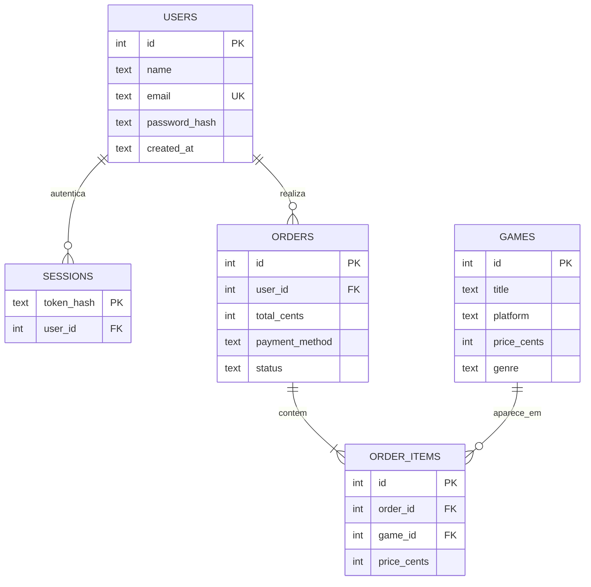

# Documentação técnica — Pixel Store

## Orientação a objetos

A organização do Back-end separa responsabilidades em classes:

- **Database** (`backend/src/database.js`) inicializa o SQLite, cria as tabelas e importa `jogos.json` na primeira inicialização.
- **GameRepository** (`backend/src/repositories.js`) consulta jogos, filtra por plataforma/busca e ordena.
- **UserRepository** (`backend/src/repositories.js`) valida dados, faz hash de senhas, cria sessões e autentica usuários.
- **OrderRepository** (`backend/src/repositories.js`) cria pedidos e recupera histórico, usando transação SQL.

No Angular, serviços `GamesService`, `AuthService`, `CartService` e `OrdersService` concentram a lógica e os componentes cuidam de apresentar as telas e capturar interações.

## Modelo relacional de banco de dados



**Relacionamentos:** um usuário pode criar várias sessões e pedidos; um pedido tem vários itens; cada item se refere a um jogo.

Os valores monetários são guardados em **centavos inteiros** (`price_cents`), evitando imprecisões em soma de valores decimais.

## Exemplos de requisições JSON

Cadastro — `POST /api/auth/register`:

```json
{"name":"Aluno Teste","email":"aluno@exemplo.com","password":"senha123"}
```

Login — `POST /api/auth/login`:

```json
{"email":"aluno@exemplo.com","password":"senha123"}
```

Pedido simulado — `POST /api/orders` com token de sessão no cabeçalho `Authorization`:

```json
{"gameIds":[5,14],"paymentMethod":"pix"}
```

Os erros da API retornam JSON, por exemplo `{"error":"Faça login para continuar."}`. As senhas são transformadas por `scrypt`, com sal aleatório, e não ficam em texto puro no banco. Nenhum dado de cartão é coletado.

## Correspondência com os protótipos

| Figura da ficha | Componente Angular | Requisito principal |
| --- | --- | --- |
| 1 Login | `pages/login/` | Autenticação persistida |
| 2 Cadastro | `pages/cadastro/` | Persistência do usuário |
| 3 Home | `pages/home/` | Destaques e atalhos |
| 4 Catálogo | `pages/catalogo/` | Busca, plataforma e ordenação |
| 5 Detalhes | `pages/detalhes-jogo/` | Informações e carrinho |
| 6 Carrinho | `pages/carrinho/` | Revisão/remover itens |
| 7 Checkout | `pages/checkout/` | Pedido simulado no banco |
| 8 Perfil | `pages/perfil/` | Histórico persistido |

## Limites do protótipo funcional

- Não existe estoque, envio de chave digital, pagamento real nem administração de produtos.
- O carrinho fica no dispositivo/navegador local; usuários diferentes no mesmo navegador devem limpar o carrinho ao trocar de conta.
- Os dados iniciais do catálogo são demonstrativos. Preços podem não corresponder ao mercado.
- Para uso em produção seriam necessários HTTPS, gerenciamento de sessões com expiração, rate limiting, controle de estoque e configurações de segurança adicionais.
